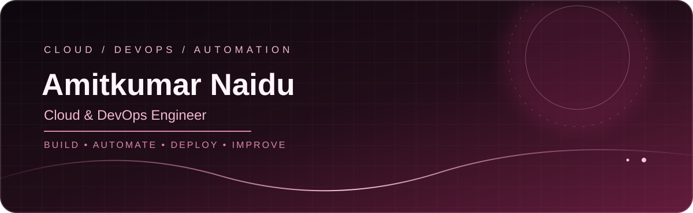
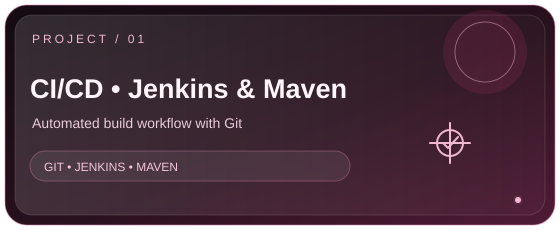
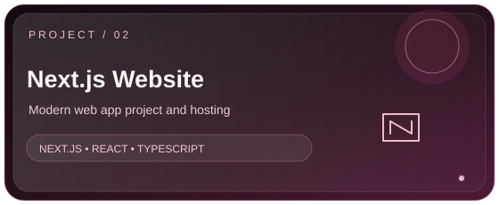
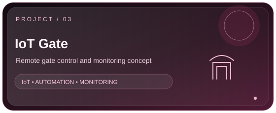
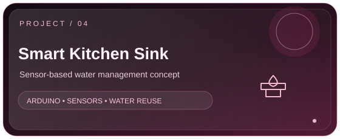
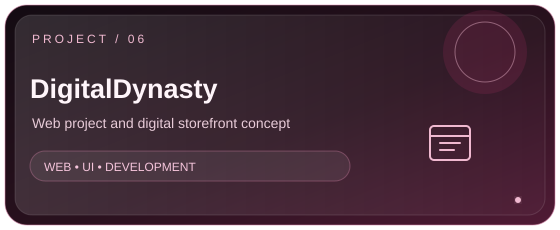

 

### ☁️ Cloud Engineering &nbsp;·&nbsp; ⚙️ DevOps &nbsp;·&nbsp; 🚀 CI/CD &nbsp;·&nbsp; 🧩 Automation

*Build it. Automate it. Deploy it. Improve it.*

---

## 👋 About Me

Hey, I'm **Amitkumar Naidu** — an MCA graduate focused on cloud infrastructure, DevOps practices, deployment automation, and practical software projects.

- ☁️ **Cloud:** AWS services and core infrastructure concepts
- 🔁 **CI/CD:** Git, GitHub, Jenkins, GitHub Actions, and Maven
- 📦 **Containers & IaC:** Docker, Kubernetes, and Terraform
- 💻 **Development:** Java, Python, JavaScript, React, Next.js, and databases
- 🎯 **Open to:** Entry-level Cloud Engineer, DevOps Engineer, and infrastructure opportunities

> 🛠️ I learn by building, troubleshooting, documenting, and improving real projects.

## ✨ Featured Projects

 

 

  
  &nbsp;
  

## 🧰 Tech Stack

### ☁️ Cloud & Infrastructure

### ♾️ DevOps & Delivery

### 💻 Programming & Web

### 🗄️ Databases & Tools

  
  
  
  

## 🏅 Certifications

 

 

## 📈 GitHub Activity

  
  
   
  

## 🤝 Let's Connect

*Building steadily. Automating thoughtfully. Learning in public.*

